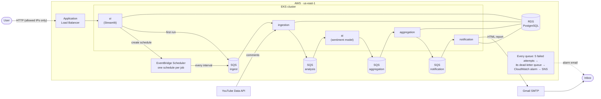
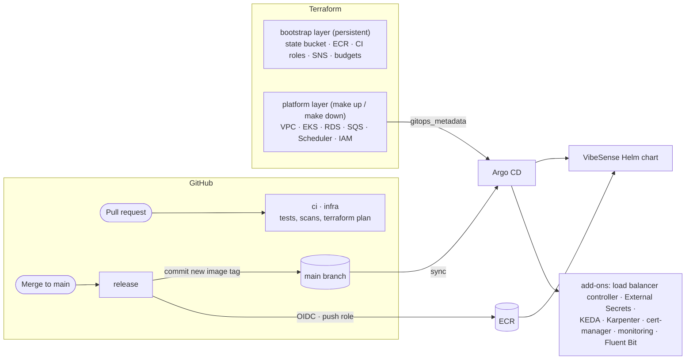
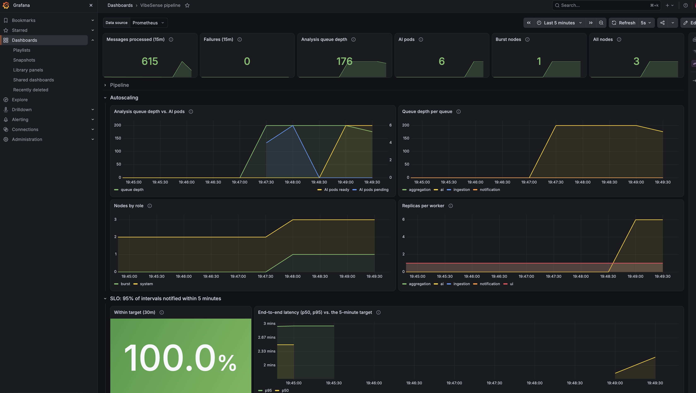
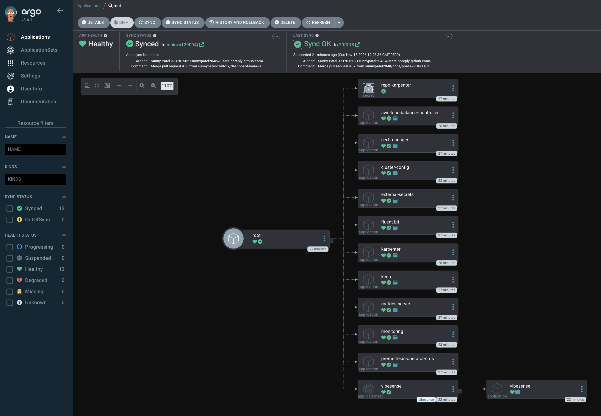

# VibeSense on EKS

**An event-driven sentiment pipeline on AWS, built, deployed, scaled and torn down entirely as code.**

VibeSense emails you how YouTube viewers feel about a video, on a schedule you
choose. This repository runs it as five Python services connected by SQS on
Amazon EKS: Terraform builds the platform, Argo CD deploys everything inside
the cluster from Git, KEDA and Karpenter scale the AI worker from zero onto
Graviton Spot nodes, and one command tears it all down to zero cost.

[](https://github.com/sunnypatel2048/vibesense-on-eks/actions/workflows/ci.yml)
[](https://github.com/sunnypatel2048/vibesense-on-eks/actions/workflows/infra.yml)
[](https://github.com/sunnypatel2048/vibesense-on-eks/actions/workflows/release.yml)
[](https://github.com/sunnypatel2048/vibesense-on-eks/actions/workflows/nightly.yml)
[](LICENSE)

## Highlights

All numbers are measured, from [`docs/measurements.md`](docs/measurements.md).

- **One command each way.** `make up` goes from nothing to a working URL in about 21 minutes; `make down` returns to zero in about 15 and proves it with a 16-point leftovers report. Two consecutive runs ended with nothing left.
- **Scale from zero.** A burst of 200 messages (10,000 comments) took the AI worker from 0 to 6 pods on newly launched Graviton Spot nodes and was fully processed in **202 s, with none lost and none doubled**. Pods were back at zero 159 s later; the extra nodes were gone after 315 s.
- **GitOps with no credentials in CI.** Argo CD installs 12 applications in dependency order. A merged change reached new pods in **261 s** with no `kubectl`. CI authenticates with short-lived OIDC credentials, can push images and read state, and can never apply Terraform.
- **Least privilege throughout.** One IAM role per workload through EKS Pod Identity, scoped to exact resources. No static AWS keys anywhere, and account-specific values (the account ID, the admin IP) are kept out of the code: Terraform hands them to Argo CD at runtime.
- **Failure is rehearsed.** Draining a busy Spot node mid-load: every AI pod Ready again in **74 s**, 200/200 messages processed. A poison message lands in its dead-letter queue and an alarm email follows.
- **An SLO, measured.** 95% of intervals notified within 5 minutes of entering the pipeline: **99.4–100%** in testing, with an alert routed to email.

## Contents

- [Architecture](#architecture)
- [How a monitoring job flows](#how-a-monitoring-job-flows)
- [Results](#results)
- [Quickstart](#quickstart)
- [Operating it](#operating-it)
- [Local development](#local-development)
- [CI/CD](#cicd)
- [Observability](#observability)
- [Security model](#security-model)
- [Failure modes](#failure-modes)
- [Cost](#cost)
- [Design decisions](#design-decisions)
- [What production would change](#what-production-would-change)
- [Repository layout](#repository-layout)
- [Known limitations and next steps](#known-limitations-and-next-steps)

## Architecture

### The pipeline



| Service | Does | Scales |
| --- | --- | --- |
| `ui` | Streamlit form: video link, name, email, plan. Creates the job and its schedule. | 1 replica ([why](deploy/charts/vibesense/README.md#why-the-ui-runs-one-replica)) |
| `ingestion` | Fetches comments newer than the last run from the YouTube Data API, cleans them, publishes a batch. | 1–3 on queue depth |
| `ai` | Scores each comment with a multilingual sentiment model baked into its image (CPU inference). | **0–6** on queue depth, on Karpenter burst nodes |
| `aggregation` | Averages the interval and the job overall; stores one row per interval (idempotent). | 1–3 on queue depth |
| `notification` | Renders and sends the HTML report; records that it did. | 1–3 on queue depth |

### The platform



Argo CD applications and their sync waves:

| Wave | Applications |
| --- | --- |
| −1 | Prometheus Operator CRDs, Helm repository for Karpenter's OCI chart |
| 0 | metrics-server, cert-manager, External Secrets, KEDA, Fluent Bit |
| 1 | AWS Load Balancer Controller, Karpenter |
| 2 | cluster-config (secret stores, Karpenter NodePool and EC2NodeClass), monitoring (kube-prometheus-stack, dashboard, SLO rules) |
| 3 | VibeSense (an ApplicationSet fed by Terraform outputs: [ADR-0016](docs/adr/0016-gitops-bridge.md)) |

| Layer | Pinned versions |
| --- | --- |
| Kubernetes / EKS | 1.37 (standard support), Amazon Linux 2023 arm64 |
| Terraform | ≥ 1.10 (tested 1.17.1), AWS provider 6.x, modules: vpc 6.7.3, eks 21.29.0 |
| Argo CD | v3.6.1 (chart 10.18.0) |
| Add-ons | AWS Load Balancer Controller 3.6.3, External Secrets 2.15.0, KEDA 2.21.0, Karpenter 1.15.2, cert-manager v1.21.3, kube-prometheus-stack 93.3.0, Fluent Bit 5.1.3 |
| App | Python 3.12, Streamlit, SQLAlchemy + Alembic, boto3, structlog, Prometheus client, PyTorch (CPU) + Transformers |

## How a monitoring job flows

1. **Submit.** In the UI, a user enters a YouTube link, name, email and plan: 1 day (report every 4 hours), 3 days (every 8 hours), 1 week (daily), or a 30-minute demo (every 5 minutes).
2. **Schedule.** The UI saves the job, creates an EventBridge Scheduler schedule that ends with the job and deletes itself, and enqueues the first fetch immediately.
3. **Ingest.** Each interval, the schedule drops a message on the ingest queue. `ingestion` fetches comments newer than the last run, cleans them, and publishes one batch to the analysis queue, stamped with `enqueued_at`.
4. **Score.** KEDA sees the analysis queue grow and scales `ai` up from zero; if no node has room, Karpenter launches a Graviton Spot node. Each comment gets a label and a confidence.
5. **Aggregate.** `aggregation` computes the interval's sentiment and the running overall, and inserts the interval row. A redelivered message hits a unique constraint and adds nothing.
6. **Notify.** `notification` sends the report, then records `notified_at`, and observes the end-to-end latency for the SLO. When the queues drain, the AI worker scales back to zero and Karpenter removes its node.

A failure at any step leaves the message in its queue: it's retried with backoff (10, 30, 90, 270 s), and after 5 attempts it moves to that queue's dead-letter queue, which raises an email alarm.

## Results

| Measurement | Result |
| --- | --- |
| `make up`: nothing → UI answering through the load balancer | 20 m 53 s |
| `make down`: everything → zero, clean leftovers report | 14–16 min |
| Merge to `main` → new pods Ready, no `kubectl` | 261 s |
| 200 messages (10,000 comments) from zero AI pods → all notified | 202 s, none lost, none doubled |
| Scale-from-zero cold start (message → first AI pod Ready) | 87 s: ~40 s new node, ~26 s image pull, ~19 s model load |
| Spot drain drill: node with 3 AI pods drained mid-load → all pods Ready | 74 s; 200/200 processed, DLQs empty |
| Queue empty → AI pods at 0 → burst nodes removed | 159 s → 315 s |
| SLO: intervals notified within 5 minutes | 99.4–100% |
| Demo job → report in a real inbox | 2–3 s |

Full results and method: [`docs/measurements.md`](docs/measurements.md).

**A load test on the dashboard:** the analysis queue jumps to 200, AI pods sit
pending while Karpenter adds a node, then turn ready and drain the queue.



**Argo CD after `make up`:** all 12 applications Synced and Healthy.



## Quickstart

### Prerequisites

| Tool | Used for |
| --- | --- |
| AWS account + [AWS CLI v2](https://docs.aws.amazon.com/cli/latest/userguide/getting-started-install.html), admin credentials | Everything in AWS |
| [Terraform](https://developer.hashicorp.com/terraform/install) ≥ 1.10 | Both infrastructure layers |
| `kubectl`, [Helm](https://helm.sh/docs/intro/install/) 3, `jq`, `curl` | Bootstrapping and operating the cluster |
| Docker with Buildx | Building the arm64 images |
| [uv](https://docs.astral.sh/uv/) + Python 3.12 | Local development and tests (optional) |
| [GitHub CLI](https://cli.github.com/), tflint 0.65, Checkov 3.4 | CI setup and infrastructure linting (optional) |

You also need a **YouTube Data API v3 key** and a **Gmail address with an
[app password](https://support.google.com/accounts/answer/185833)** for sending reports.

### One-time setup

```bash
git clone https://github.com/sunnypatel2048/vibesense-on-eks.git && cd vibesense-on-eks
```

**1. The persistent layer** (state bucket, ECR, CI roles, alert topic, budgets).
Copy `infra/bootstrap/terraform.tfvars.example` to `terraform.tfvars`, set
`alerts_email`, then follow [`infra/bootstrap/README.md`](infra/bootstrap/README.md):
it creates the state bucket and moves its own state into it. Confirm the SNS
subscription email that arrives.

**2. Platform settings.** Copy `infra/platform/terraform.tfvars.example` to
`terraform.tfvars` and set `admin_cidrs` to your IP (`curl -s https://checkip.amazonaws.com`).
Only this address can reach the cluster's API and the UI.

**3. Secrets.** Stored in SSM Parameter Store, never in Terraform or Git:

```bash
make secrets          # prompts for the YouTube key and Gmail credentials (hidden); generates Grafana's password
make secrets-check    # lists the 4 parameters, never their values
```

**4. Images.** Build both arm64 images and push them to ECR, tagged with the
current commit, then put that tag in `deploy/charts/vibesense/values.yaml`
(after this, every merge to `main` does it automatically):

```bash
make push
```

> **Running it from a fork?** Argo CD deploys from this repository's URL. Replace
> `sunnypatel2048/vibesense-on-eks` in `deploy/` with your repository, and set
> `github_repository`, `github_owner_id` and `github_repository_id` in
> `infra/bootstrap/variables.tf` so the CI roles trust your repository.

### Every session

```bash
make up       # ~21 min: pre-flight checks, Terraform, Argo CD, waits for all 12 apps and the UI; prints the URL
make status   # nodes, apps, pods, queue depths
make down     # ~15 min: tears down in the safe order, then runs the leftovers report
```

A running platform costs roughly $0.20–0.25 an hour (see [Cost](#cost)), so
`make down` after every session matters. A nightly CI job checks for anything left behind.

### CI on your fork (optional)

```bash
# Repository secrets (values piped from Terraform outputs and your gitignored tfvars)
terraform -chdir=infra/bootstrap output -json ci_role_arns | jq -r .plan | gh secret set AWS_PLAN_ROLE_ARN
terraform -chdir=infra/bootstrap output -json ci_role_arns | jq -r .push | gh secret set AWS_PUSH_ROLE_ARN
terraform -chdir=infra/bootstrap output -raw state_bucket | gh secret set TF_STATE_BUCKET
sed -n 's/^alerts_email *= *"\(.*\)".*/\1/p' infra/bootstrap/terraform.tfvars | gh secret set TF_VAR_ALERTS_EMAIL
sed -n 's/^admin_cidrs *= *//p' infra/platform/terraform.tfvars | gh secret set TF_VAR_ADMIN_CIDRS

# A "release" environment, usable only from main, holding a deploy key for tag bumps
R=$(gh repo view --json nameWithOwner --jq .nameWithOwner)
echo '{"deployment_branch_policy":{"protected_branches":false,"custom_branch_policies":true}}' \
  | gh api -X PUT repos/$R/environments/release --input -
gh api -X POST repos/$R/environments/release/deployment-branch-policies -f name=main -f type=branch
ssh-keygen -t ed25519 -N "" -C "release workflow" -f /tmp/release-key
gh repo deploy-key add /tmp/release-key.pub --allow-write --title "release workflow"
gh secret set RELEASE_DEPLOY_KEY --env release < /tmp/release-key && rm /tmp/release-key /tmp/release-key.pub

# Branch protection, from .github/rulesets/main.json
make ruleset
```

## Operating it

| Command | What it does |
| --- | --- |
| `make up` / `make down` | Whole platform up from nothing / down to zero cost ([`scripts/up.sh`](scripts/up.sh), [`scripts/down.sh`](scripts/down.sh)) |
| `make status` | Cluster, nodes by role and capacity type, Argo CD apps, pods, queue and DLQ depths |
| `make leftovers` | 16 checks for anything from the platform layer still in AWS; exits 1 if any is found |
| `make cost` | This month's spend by service (Cost Explorer; $0.01 per call) |
| `make grafana` | Prints the Grafana login and port-forwards it to http://localhost:3000 |
| `make load JOBS=20 MESSAGES=200` | Load test in the cluster; ends with an exactly-once check and a scaling summary |
| `make drill` | Spot interruption drill: drains a busy burst node mid-load and measures recovery |
| `make trace JOB=<id> [SOURCE=cloudwatch]` | One job's log lines from every service, in time order |
| `make load-clean` | Deletes the load test's synthetic jobs |
| `make push` | Builds both images and pushes them to ECR tagged with the commit (CI does this on merge) |
| `make secrets` / `make secrets-check` | Writes / lists the app secrets in SSM |
| `make ruleset` | Applies branch protection from `.github/rulesets/main.json` |

`make down` runs six steps in an order that leaves nothing behind. Each one
removes something the cluster created that Terraform can't see:

1. Delete Argo CD's root app (without cascading), so self-heal stops recreating what's deleted next.
2. Delete the app; wait for its Ingress, which the load balancer controller releases only after deleting the ALB.
3. Delete the cluster config; Karpenter drains its nodes and removes the instance profile it created.
4. `terraform destroy` the cluster first.
5. Delete network interfaces the VPC CNI left behind, which would otherwise block deleting the subnets.
6. `terraform destroy` the rest, then run the leftovers report.

## Local development

The whole pipeline runs locally from the same images, with ElasticMQ standing in
for SQS, a local scheduler for EventBridge Scheduler, and Mailpit for Gmail:

```bash
uv venv --python 3.12 && source .venv/bin/activate
UV_INDEX_STRATEGY=unsafe-best-match uv pip install -r requirements/dev.txt
echo "YOUTUBE_API_KEY=..." > .env
make dev-up          # UI: http://localhost:8501   Inbox: http://localhost:8025
make dev-logs
make dev-down        # dev-reset also deletes the local database
```

| Check | Command |
| --- | --- |
| Lint (ruff) | `make lint` |
| Unit tests (pytest; moto and botocore stubs stand in for AWS) | `make test` |
| Helm chart lint and render | `make lint-chart` |
| Terraform fmt, tflint, Checkov | `make lint-infra` |
| Model output unchanged after an ML dependency upgrade | see [`scripts/sentiment_golden.py`](scripts/sentiment_golden.py) |
| Regenerate the lock files | `make lock` |

Dependencies are fully pinned lock files generated by uv from
`requirements/*.in`: one universal file for development, and Linux arm64 files
for each image (PyTorch's CPU-only build).

## CI/CD

| Workflow | Trigger | Does |
| --- | --- | --- |
| [`ci.yml`](.github/workflows/ci.yml) | Every pull request | ruff, pytest, Helm lint; builds both images natively on arm64 runners; **Trivy** fails on any fixable HIGH/CRITICAL vulnerability; the **golden check** fails if the model's output drifts |
| [`infra.yml`](.github/workflows/infra.yml) | Every pull request; works only when `infra/` changes | `terraform fmt`, `validate`, tflint, Checkov; then `terraform plan` for both layers through the read-only role, summarised in a PR comment |
| [`release.yml`](.github/workflows/release.yml) | Merge to `main` changing image inputs | Builds, scans, pushes `:<commit>` to ECR, then commits the new tag to the chart; Argo CD rolls it out |
| [`nightly.yml`](.github/workflows/nightly.yml) | Daily | Runs the leftovers report with the read-only role; a failure sends an email |
| Dependabot | Weekly | Updates the SHA-pinned GitHub Actions |

`main` is protected by a [ruleset kept in Git](.github/rulesets/main.json):
pull requests only, `ci passed` and `infra passed` required (and accepted only
from GitHub Actions itself), no force pushes. The release workflow's deploy key
is the only bypass.

## Observability

- **Metrics:** kube-prometheus-stack (Prometheus, Grafana, Alertmanager), 6 hours of retention on ephemeral storage. Every worker exports messages handled and processing time, and notification records end-to-end latency; KEDA exports queue depth; kube-state-metrics and Karpenter cover pods and nodes.
- **Dashboard as code:** [`deploy/monitoring/dashboards/vibesense-pipeline.json`](deploy/monitoring/dashboards/vibesense-pipeline.json): throughput, errors and p50/p95 processing time per stage; queue depth against AI pods (ready and pending); nodes by role; the SLO.
- **SLO:** 95% of intervals notified within 5 minutes of their comments entering the pipeline. Recording rules and the alert are in [`deploy/monitoring/slo-rules.yaml`](deploy/monitoring/slo-rules.yaml), including why the target is 5 minutes and not 2. The alert reaches email through Alertmanager → SNS, and only this project's alerts do.
- **Logs:** every service writes JSON with `job_id` attached to every line handled for a job. Fluent Bit ships the app's logs to CloudWatch Logs (1-day retention), so logs of pods KEDA has removed are still searchable. `make trace JOB=<id>` follows one job across all services.

## Security model

**No long-lived AWS credentials exist anywhere:** not in pods, not in CI, not on
nodes the app can reach. Details, the vulnerability policy and every accepted
scanner finding with its reason: [`docs/security.md`](docs/security.md).

### What each workload may do in AWS

One IAM role per workload, bound to its Kubernetes service account by EKS Pod Identity:

| Workload | Allowed | Nothing else |
| --- | --- | --- |
| ingestion | Receive/delete on the ingest queue; send to the analysis queue | |
| ai | Receive/delete on the analysis queue; send to the aggregation queue | no database, no secrets |
| aggregation | Receive/delete on the aggregation queue; send to the notification queue | |
| notification | Receive/delete on the notification queue | |
| ui | Create/delete schedules in the `vibesense` group; pass only the scheduler role; send to the ingest queue | |
| External Secrets | Read `/vibesense/secrets/*` and `/vibesense/platform/*`; read the one RDS-managed secret | |
| KEDA | `GetQueueAttributes` on the four queues: counts, never messages | |
| Alertmanager | Publish to the one alerts topic | |
| Fluent Bit | Write to the one app log group | |
| Load balancer controller, Karpenter | AWS's published policies for those controllers | |
| CI (pull requests) | Read-only, plus the Terraform state lock; explicitly denied the app's secrets | no apply |
| CI (main) | Push to the two ECR repositories | no apply |

### Secrets, network, containers, supply chain

- **Secrets:** SSM Parameter Store SecureStrings, written by a script, never by Terraform (its state would hold the values). External Secrets copies them into Kubernetes Secrets, and each pod receives only the variables it lists. The database password is generated by RDS and kept in Secrets Manager; no person or tool ever handles it.
- **Network:** the EKS API and the ALB accept only the admin's IP. Inside the cluster, network policies deny all incoming traffic to the app except the UI's port and Prometheus scrapes. RDS sits in subnets with no internet route, reachable only from the nodes. Pods on Karpenter's nodes can't reach the instance metadata service.
- **Containers:** non-root (UID 10001), read-only root filesystem, all capabilities dropped, no privilege escalation, `RuntimeDefault` seccomp. The base image is pinned by digest and the model by revision.
- **Supply chain:** Trivy gates every build and every release. GitHub Actions are pinned to commit SHAs. OIDC trust policies match the exact subject, including the repository's numeric ID. The account ID and admin IP are kept out of the repository's code and configuration: Terraform passes them to Argo CD through the cluster record ([ADR-0016](docs/adr/0016-gitops-bridge.md)).

## Failure modes

| What goes wrong | What happens | Verified |
| --- | --- | --- |
| A message can't be processed (poison message) | Retried at 10, 30, 90, 270 s; after 5 attempts it moves to the queue's DLQ; a CloudWatch alarm emails | Yes: malformed message → DLQ → alarm email |
| A worker is stopped mid-message | On SIGTERM it stops polling and hands unfinished messages back to SQS; if killed outright, the visibility timeout returns them | Yes, as part of the drain drill |
| A Spot node is reclaimed | Karpenter receives the interruption notice, cordons and drains the node, and launches a replacement; messages are redelivered | Simulated with a drain: 74 s to recover, none lost |
| A message is delivered twice | The unique `(job_id, timestamp)` constraint absorbs the duplicate; `notified_at` prevents a second email in all but a crash-between-send-and-save | Yes: load tests check notified == sent |
| A worker hangs | Liveness probes distinguish *busy* from *stuck* (busy longer than the queue's visibility timeout) and restart it | Unit tested |
| A release would break the schema | Migrations run as a sync hook before new pods; a failed migration fails the sync, and pods refuse to start on an outdated schema | By design |
| A dependency upgrade changes the model's answers | The golden check fails the pull request | Yes, in CI |
| A new CVE with a fix appears | Trivy fails the pull request or the release | Yes: caught five on its first run |
| The cluster is left running | The nightly leftovers check fails and emails; AWS Budgets alert at $1/day and $10/month | Leftovers check runs nightly |

## Cost

Approximate us-east-1 rates while the platform is up; the definitive number is
`make cost` the day after a session.

| Item | Rate |
| --- | --- |
| EKS control plane (standard support) | $0.10 / hour |
| 2 × Graviton Spot system nodes | ≈ $0.02–0.03 / hour each |
| Application Load Balancer | ≈ $0.0225 / hour + usage |
| RDS `db.t4g.micro` | ≈ $0.016 / hour |
| Public IPv4 addresses | $0.005 / hour each (≈ 4) |
| Karpenter burst nodes | only while the AI worker has work |
| SQS, EventBridge Scheduler, Parameter Store, CloudWatch Logs | ≈ $0 at demo volume |
| **Running total** | **≈ $0.20–0.25 / hour** (a 90-minute session ≈ $0.35) |
| **Persistent** (state bucket, ECR images, kept to 5 per repository) | **< $1 / month** |

Choices that keep it there: no NAT gateway, Spot Graviton everywhere, the AI
worker at zero when idle, no persistent volumes, no control-plane logs, no
customer-managed KMS keys, and EKS kept on a version in standard support
(extended support is $0.60 / hour).

## Design decisions

Each decision has a short record with its context, consequences and rejected
alternatives in [`docs/adr/`](docs/adr/README.md).

| Decision | Chosen | Instead of |
| --- | --- | --- |
| [Messaging](docs/adr/0001-sqs-instead-of-rabbitmq-celery.md) | SQS + a DLQ per queue | RabbitMQ and Celery |
| [Scheduling](docs/adr/0002-eventbridge-scheduler-per-job.md) | EventBridge Scheduler, one self-deleting schedule per job | Celery Beat + Redis |
| [Compute](docs/adr/0003-eks-with-karpenter.md) | EKS, small node group + Karpenter | ECS on Fargate, EKS Auto Mode |
| [Instances](docs/adr/0004-graviton-and-spot.md) | Graviton Spot | x86 on-demand |
| [Network](docs/adr/0005-public-subnets-no-nat.md) | Public subnets, no NAT gateway | Private subnets + NAT |
| [Infrastructure as code](docs/adr/0006-two-terraform-layers.md) | Terraform, persistent + ephemeral layers | One state file |
| [Cluster software](docs/adr/0007-argo-cd-app-of-apps.md) | Argo CD app-of-apps | Terraform's Helm provider |
| [Secrets](docs/adr/0008-secrets-in-ssm-via-external-secrets.md) | Parameter Store + External Secrets | Secrets Manager, secrets in Git |
| [Pod credentials](docs/adr/0009-pod-identity-per-workload.md) | EKS Pod Identity, a role per workload | IRSA, the node role |
| [Autoscaling](docs/adr/0010-keda-queue-depth-scale-to-zero.md) | KEDA on queue depth, scale to zero | HPA on CPU |
| [Observability](docs/adr/0011-observability-and-slo.md) | In-cluster Prometheus/Grafana, a 5-minute SLO | Managed Prometheus/Grafana |
| [Database](docs/adr/0012-rds-postgresql.md) | RDS PostgreSQL, single-AZ | In-cluster Postgres, Aurora |
| [Model serving](docs/adr/0013-model-baked-into-image.md) | Baked into the image, golden check | Download at startup, SageMaker |
| [Migrations](docs/adr/0014-migrations-as-sync-hook.md) | Alembic Job as an Argo CD Sync hook | `create_all()`, PreSync hook |
| [Email](docs/adr/0015-gmail-smtp.md) | Gmail SMTP | Amazon SES (sandbox) |
| [Account-specific values](docs/adr/0016-gitops-bridge.md) | GitOps Bridge through the cluster record | Committing them to Git |
| [Webhook certificates](docs/adr/0017-webhook-certs-from-cert-manager.md) | cert-manager at runtime | Generated at chart render |
| [Delivery semantics](docs/adr/0018-at-least-once-idempotent-writes.md) | At-least-once + idempotent writes | FIFO queues |
| [CI access](docs/adr/0019-ci-oidc-no-apply-role.md) | OIDC, no apply role, pinned actions | Access keys, push-based deploys |

## What production would change

| Area | This project | Production |
| --- | --- | --- |
| Network | Public subnets, no NAT | Private subnets with NAT gateways or VPC endpoints; egress filtering by domain |
| Edge | HTTP on the ALB's name, IP allow-list | TLS from ACM, a Route 53 domain, AWS WAF, authentication |
| Accounts | One account | AWS Organizations: separate accounts per environment, an ApplicationSet per cluster |
| Database | Single-AZ, password auth, no deletion protection | Multi-AZ or Aurora, IAM authentication, RDS Proxy, deletion protection, tested restores |
| Releases | Rolling updates | Argo Rollouts canaries gated on the SLO |
| Observability | In-cluster, 6 hours | Amazon Managed Prometheus and Grafana, long-term storage, distributed tracing (OpenTelemetry) |
| Email | Gmail SMTP | Amazon SES with DKIM, bounce and complaint handling |
| Auditing | No control-plane logs | EKS audit logs, CloudTrail data events, customer-managed KMS keys |
| Supply chain | Trivy gate | Signed images (cosign) verified by an admission policy (Kyverno), SBOMs |
| Nodes | Latest AL2023 AMI, Spot only | Pinned AMIs, a mix of on-demand and Spot for critical capacity, PodDisruptionBudgets |
| UI | 1 replica | Sticky sessions on the ALB and multiple replicas |

## Repository layout

```text
.
├── src/                     # The five services, plus shared code in src/common/ (queue, config, logging, metrics, health)
├── tests/                   # pytest; moto and botocore stubs stand in for AWS
├── alembic/                 # Database migrations (the only schema owner)
├── Dockerfile               # Two images: app (UI + 3 workers) and ai (model baked in)
├── docker-compose.yml       # The whole pipeline locally, from the same images
├── infra/
│   ├── bootstrap/           # Persistent layer: state bucket, ECR, CI roles, SNS, budgets
│   ├── platform/            # Ephemeral layer: VPC, EKS, Karpenter, RDS, SQS, Scheduler, IAM
│   └── modules/             # sqs-with-dlq, workload-role (Pod Identity)
├── deploy/
│   ├── root-app.yaml        # Argo CD's root application
│   ├── apps/                # One Argo CD Application per add-on, plus the VibeSense ApplicationSet
│   ├── platform/            # Helm values for each add-on
│   ├── charts/vibesense/    # The app's Helm chart
│   ├── cluster-config/      # Secret stores, Karpenter NodePool and EC2NodeClass
│   └── monitoring/          # Dashboard, SLO rules, Alertmanager routing, Grafana login
├── scripts/                 # up, down, leftovers, status, cost, load test, drill, trace, secrets, bootstrap
├── docs/                    # Measurements, security, architecture decision records, screenshots
└── .github/                 # Workflows, Dependabot, the branch ruleset
```

## Known limitations and next steps

- **Distributed tracing** (OpenTelemetry spans carried in SQS message attributes, Tempo in the cluster) is designed but not built.
- The UI runs one replica, over plain HTTP, restricted to one IP. Fine for a demo, not for users.
- Gmail's sending limits cap real volume; SES is the path beyond a demo.
- The SLO has been measured under synthetic load tests, not under real traffic.
- Burst nodes use the latest Amazon Linux 2023 AMI, so a new AMI release replaces them; production would pin a version.

## License

[MIT](LICENSE)
