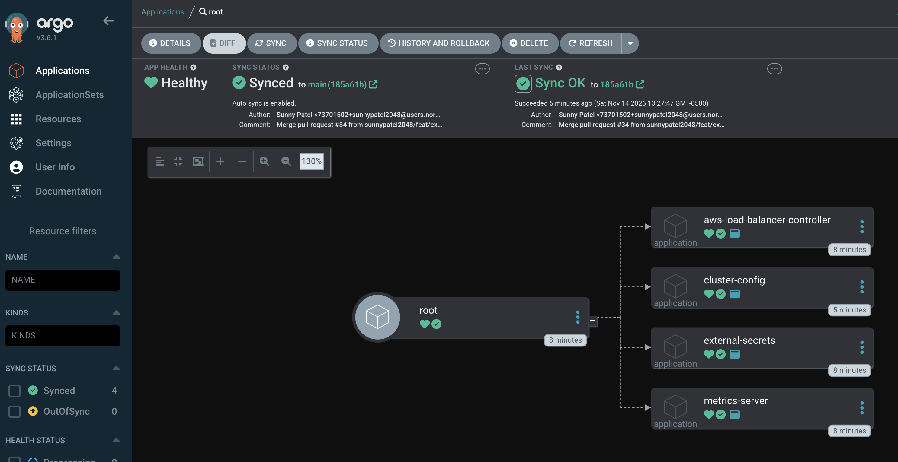

# Measurements

Numbers measured on real runs, for the README and for sizing decisions.
Re-measure when something here changes; keep the date.

## Platform lifecycle (us-east-1, EKS 1.37, 2x Spot Graviton system nodes)

| What | Time | Measured | Notes |
| --- | --- | --- | --- |
| `terraform apply` (infra/platform, ~94 resources) | 13–15 min | 2026-11-14: 14 m 49 s | EKS control plane and RDS dominate |
| `make argocd` → every Argo CD app Synced/Healthy | 3 m 30 s | 2026-11-14: 210 s | 5 apps: root, metrics-server, aws-load-balancer-controller, external-secrets, cluster-config. Wave 1 waits for wave 0 to be Healthy |
| `terraform destroy` | ~12 min | 2026-11-14: 12 m 14 s | |
| Running cost while up | ~$0.19/hour | | Torn down after every session |

## Images and the AI service

| What | Value | Notes |
| --- | --- | --- |
| `app` image | 1.35 GB | Streamlit UI and the pipeline workers |
| `ai` image | 2.43 GB (~790 MB compressed in ECR) | CPU-only PyTorch, model baked in at a pinned revision |
| AI worker restart → healthy | < 10 s | Model loads from the image, no download (local compose) |
| Job created → first email | 1–2 s | Local compose with Mailpit |
